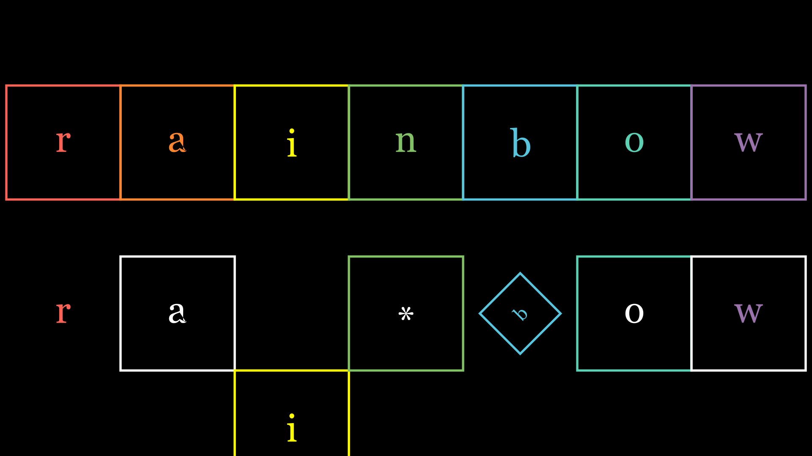
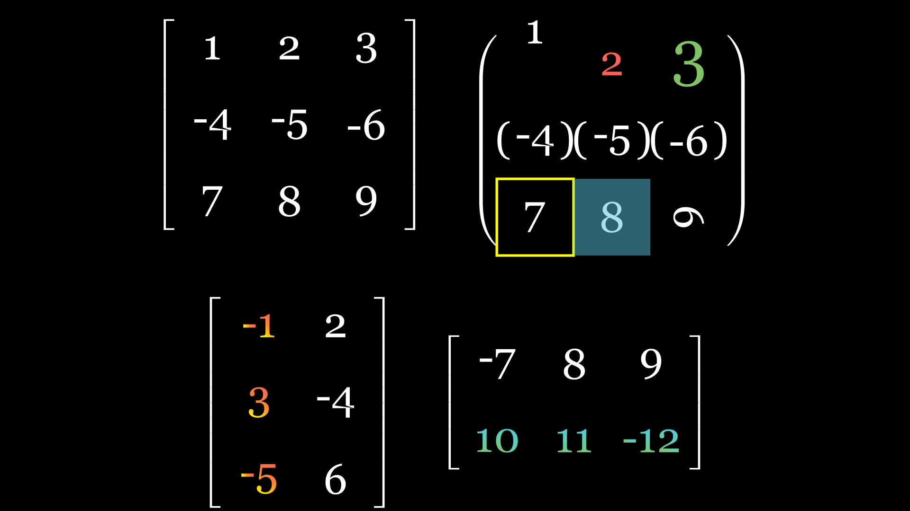

# rainbow_yu🐋✨
在manim基础上进行的动画控制和运算的改进或添加，
基础的manim知识请参考[manim](https://github.com/manimCommunity/manim)

[](README.md) [](README-ch.md)
---

使用方法： 
1. 需要先配置latex环境
- 详细下载请参考 [texlive](https://tug.org/texlive/)
> [!Warning]
> **WARNING:** 注意配置latex的环境变量
2. 安装依赖包
- 基于 `python 3.10` 开发，最低版本不低于 `python 3.8`
```bash
git clone https://github.com/rainbowyuyu/manim_extend_rainbow.git
cd ./manim_extend_rainbow
pip install -r requirements.txt
```

---

文件结构：  
yty_manim  
├── [examples.ipynb](examples/examples.ipynb)  
├── [disposition](yty_manim%2Fdisposition)  
│ ├── [speed_rate_fuc.py](yty_manim%2Fdisposition%2Fspeed_rate_fuc.py)  
│ ├── [speed_rate_fuc.md](yty_manim%2Fdisposition%2Fspeed_rate_fuc.md)  
│ └── [fonts_and_colors.py](yty_manim%2Fdisposition%2Ffonts_and_colors.py)  
├── [basic_unit](yty_manim%2Fbasic_unit)  
│ ├── [squ_tex.py](yty_manim%2Fbasic_unit%2Fsqu_tex.py)  
│ ├── [dec_bin.py](yty_manim%2Fbasic_unit%2Fdec_bin.py)  
│ ├── [screen_cycle.py](yty_manim%2Fbasic_unit%2Fscreen_cycle.py)  
│ ├── [threed_vgp.py](yty_manim%2Fbasic_unit%2Fthreed_vgp.py)  
│ ├── [code_step.py](yty_manim%2Fbasic_unit%2Fcode_step.py)  
│ ├── [shapes.py](yty_manim%2Fbasic_unit%2Fshapes.py)  
│ ├── [cs2_arena.py](yty_manim%2Fbasic_unit%2Fcs2_arena.py)  
│ ├── [cs2_damage.py](yty_manim%2Fbasic_unit%2Fcs2_damage.py)  
│ └── [cs2_map.py](yty_manim%2Fbasic_unit%2Fcs2_map.py)  
├── [application](yty_manim%2Fapplication)  
│ ├── [matrix_yty.py](yty_manim%2Fapplication%2Fmatrix_yty.py)  
│ ├── [page_replacement.py](yty_manim%2Fapplication%2Fpage_replacement.py)  
│ ├── [title_animate.py](yty_manim%2Fapplication%2Ftitle_animate.py)  
│ └── [s.py](yty_manim%2Fapplication%2Fs.py)  
└── [tools](yty_manim%2Ftools)  
  └── [map_editor](yty_manim%2Ftools%2Fmap_editor)  

video_project  
└── [cs2_c4](video_project%2Fcs2_c4)  
  ├── [manim](video_project%2Fcs2_c4%2Fmanim)  
  ├── [cs2_c4_data](video_project%2Fcs2_c4%2Fcs2_c4_data)  
  ├── [cs2_c4_edit](video_project%2Fcs2_c4%2Fcs2_c4_edit)  
  └── [cs2_c4_footage](video_project%2Fcs2_c4%2Fcs2_c4_footage)  

---

# disposition

---

## speed_rate_fuc.py

Manim `rate_func` 缓动曲线集合（多项式 / sine·expo·circ / back·elastic·bounce / 往返抖动等）。

完整说明、选用建议与每条曲线的示例 GIF：  
→ **[speed_rate_fuc.md](yty_manim/disposition/speed_rate_fuc.md)**

```python
from yty_manim.disposition.speed_rate_fuc import ease_in_out_cubic, rate_presets

self.play(mob.animate.shift(RIGHT), rate_func=ease_in_out_cubic)
self.play(..., rate_func=rate_presets["ease_out_back"])
```

重新渲染示例动画：

```bash
python examples/render_speed_rate_gifs.py
```

## fonts_and_colors.py

字体列表、渐变色板、`typedict` 形状样式，以及 CS2 相关默认颜色（`cs2_arena_3d` / `cs2_damage` / `cs2_mirage_map` 等）。

---

# basic_unit

---

## squ_tex.py
包含类 `SquTex`、`SquTexSlide` 和 `Stack`



---

### SquTex

数据块， 继承于 :class:`~.VGroup` ，
- 常用于数据结构的演示和二进制编码的演示，
- 将方块和数字整合在一起，支持统一的动画和单个动画，
- :param:`distance` 成员记录了第一次构造数据间的间距
- 单个动画使用 :method:`animate_one_by_one` 将动画编为一个组
- 在创建数据块时，把所有的可变参数 kwargs 赋给了 :class:`~.Square` 类。
- 如果需要改变其他参数，使用 :method:`change_square` 以及 :method:`change_text` ，
- 但要注意使用 :method:`change_text` 时会将原对象的层次改变。
- 使用 :method:`add_bracket` 将数据块中所有负数的数字都加上括号

使用示例：

```python
from manim import *
from yty_manim.basic_unit.squ_tex import SquTex

class SquTexCreate(Scene):
    def construct(self):
        t = SquTex("rainbow")
        self.play(t.animate_one_by_one(FadeIn , scale=1.5))
        self.wait()
```

---

### SquTexSlide

演示滑动的数据块， 继承于 :class:`~.SquTex` ，
- 在数据块的基础上添加滑动的动画，
- 使用 :method:`slide` 做基本的位置变化滑动
- 使用 :method:`slide_fade` 做数据块内部或外部添加的循环滑动，并且头尾缓入缓出

使用示例：

```python
from manim import *
from yty_manim.basic_unit.squ_tex import SquTexSlide

class SquTexSlideBasic(Scene):
    def construct(self):
        s = SquTexSlide("rainbow")
        self.add(s)
        self.wait()
        for i in range(len(s)):
            self.play(*s.slide(-1))
        self.wait()
```

---

### Stack

展示栈结构的数据块， 继承于 :class:`~.SquTexSlide` ，
- 在滑动数据块基础上增加数据结构变换：交换、翻转、指针跟随
- 使用 :method:`move_pointer` 移动指针到指定下标
- 使用 :method:`swap` / :method:`reverse` 交换或翻转元素（`play` 时需解包动画组）
- 重构了 :method:`pop` / :method:`push`，可与指针联动

使用示例：

```python
from manim import *
from yty_manim.basic_unit.squ_tex import Stack
from yty_manim.disposition.fonts_and_colors import gradient_dict, typedict

class StackClass(Scene):
    def construct(self):
        lst = [1, 2, 3, 4, 5]
        s = Stack(lst, pointer_direction=UP, need_pointer=True, **typedict["default_st_type"])
        for i in range(len(lst)):
            s[i].set_color(gradient_dict["rainbow_color"][i % 7])
        self.play(Create(s))
        self.play(s.animate.move_pointer(2))
        self.play(*s.swap(0, 3))
        self.play(*s.reverse())
        self.wait()
```

---

## dec_bin.py
包含类 `BinNumber` 和 `Bin4SquTex`
- `BinNumber` 负责二进制数值逻辑；`Bin4SquTex` 计划把二进制展示接到 `SquTex` 动画接口（仍在完善中）

---

### BinNumber

数据块中的二进制数。
通过记录符号位、整数部分、小数部分，
将十进制数转换为理想的二进制格式，
并且能对二进制数进行一些处理，

- 先用空值对类对象进行赋值，输入 bin_num 后使用 :method:`bin2dec` 将二进制数类对象转化为一个十进制数，
- 使用 :method:`standardize` 将二进制数类对象进行格式标准化，
- 使用 :method:`ex_one` 将二进制数类对象转化为其反码，
- 使用 :method:`ex_two` 将二进制数类对象转化为其补码，
- 使用 :method:`information` 显示该二进制数的所有参数信息，
- 使用 :method:`cal_check` 检验在算法运算时是否会超出精度，
- 使用计算方法重载时，格式跟随第一目继承。

使用示例：

```python
from yty_manim.basic_unit.dec_bin import BinNumber

# 定义十进制数转换二进制数
test_bin = BinNumber(-0.2, 8, 1, True)
print(test_bin)
print(test_bin.ex_one())
print(test_bin.ex_two())
```

---

## screen_cycle.py
包含类 `ScreenCycle` 和 `Directory`

---

### ScreenCycle

画面屏幕轮播， 继承于 :class:`~.VGroup` ，
- 常用于开始介绍界面的标题画面轮播，以及把当前标题收至边角
- 构造时传入标题字符串列表，可统一设置字体、渐变色、行间距与放大倍率
- 使用 :method:`step_forward` 向前切换标题（高亮当前项、弱化其余项）
- 使用 :method:`set_to_edge` / :method:`set_back` 将标题收至边角或还原到中央轮播

使用示例：

```python
from manim import *
from yty_manim.basic_unit.screen_cycle import ScreenCycle

class ScreenTest(Scene):
    def construct(self):
        text_list = [
            "Hello World",
            "Hell Worl",
            "Hel Wor",
            "He Wo",
        ]
        s = ScreenCycle(text_list)
        self.add(s)
        for i in range(len(text_list)):
            self.play(s.animate.step_forward())
        self.play(s.animate.set_to_edge(UL))
        self.play(s.animate.set_back())
```

---

### Directory

目录演示， 继承于 :class:`~.VGroup` ，
- 常用于片头章节目录：左侧圆点时间线 + 右侧章节标题
- 使用 :method:`step_forward` 逐步点亮下一项，适合配合旁白推进

使用示例：

```python
from manim import *
from yty_manim.basic_unit.screen_cycle import Directory
from yty_manim.disposition.fonts_and_colors import text_font

class DirectoryPage(Scene):
    def construct(self):
        title = [
            "页面与页面置换",
            "抖动与 belady",
            "页面置换算法",
            "栈结构",
            "编程代码",
        ]
        d = Directory(title, font=text_font[0])
        d[1].set_color(GRAY)
        self.play(Write(d[0:2]), run_time=2)
        for i in range(len(title)):
            d.step_forward(self)
```

---

## threed_vgp.py
包含类 `ThreeDVgp`

---

### ThreeDVgp

三维层叠物件， 继承于 :class:`~.VGroup` ，
- 将任意二维物件沿 `OUT` 方向复制多层，形成“挤出”厚度感
- 使用 :method:`set_depth_gradient_color` 设置沿深度方向的颜色渐变
- 使用 :method:`set_depth_gradient_opacity` 设置沿深度方向的透明度渐变
- 使用 :method:`animate_together` 对每一层同步施加同一动画
- 使用 :method:`set_shade` 给底层加阴影偏移

使用示例：

```python
from manim import *
from yty_manim.basic_unit.threed_vgp import ThreeDVgp
from yty_manim.disposition.fonts_and_colors import color_dict

class PictureShow(ThreeDScene):
    def construct(self):
        self.camera.background_color = color_dict["bg"]
        t2d = Text("rainbow鱼")
        t3d = ThreeDVgp(t2d, layer_depth=20)
        self.set_camera_orientation(0.25 * PI, -0.25 * PI, 0.25 * PI)
        t3d.set_depth_gradient_opacity([0, 1])
        t3d.set_depth_gradient_color(WHITE, BLUE_D)
        self.add(t3d)
```

---

## code_step.py
包含类 `CodeStep`

---

### CodeStep

可分步写出的代码块， 继承于 :class:`~.Code` ，
- 在 Manim `Code` 之上记录已写出的行数，便于逐步揭示
- 使用 :method:`write_code` 按行写出；`is_auto_runtime=True` 时按字符量自动估算时长
- 适合讲解伪代码、算法步骤时与旁白同步推进

使用示例：

```python
from manim import *
from yty_manim.basic_unit.code_step import CodeStep

class CodeShow(Scene):
    def construct(self):
        c1 = CodeStep(
            code_string="a = 1\nb = 2\nprint(a + b)",
            language="python",
        )
        self.add(c1)
        for i in range(len(c1[2])):
            c1.write_code(self, 1, is_auto_runtime=True)
            self.wait(0.3)
```

---

## shapes.py
包含类 `Book`

---

### Book

书本造型， 继承于 :class:`~.VGroup` ，
- 由封面矩形、侧面厚度、顶部切口与竖排标题组成
- `index` 控制 `z_index`，多本书叠放时可用于前后层关系
- `fill_color` / `stroke_color` 分别控制封面填充与描边
- 常用于片头、书架、课程章节一类的装饰构图

使用示例：

```python
from manim import *
from yty_manim.basic_unit.shapes import Book

class BookShape(Scene):
    def construct(self):
        b1 = Book("...", 0, BLUE, BLUE_E)
        b2 = Book("CV", 1, GREEN, GREEN_E)
        self.add(b1.shift(LEFT * 0.5), b2)
        self.wait()
```

---

## cs2_arena.py
包含类 `Arena3D`、`GridMap2D`、`AlgoSpec` 等，以及共享玩具地图常量 `GRID`、`BOMB_IJ`、`SURVIVOR_IJ`
- 三维竞技场与二维寻路网格共用同一套格子拓扑，便于“球体穿墙 vs 路径波前”对照讲解

---

### Arena3D

CS2 C4 风格三维竞技场， 继承于 :class:`~.VGroup` ，
- 基于 `GRID` 生成地板片、合并墙体、炸弹与幸存者标记
- 常与冲击波 / 球体爆炸对比的 `ThreeDScene` 一起使用
- 模块内还提供 `_bfs_dist` / `_bfs_path`、伤害上色等辅助函数

使用示例：

```python
from manim import *
from yty_manim.basic_unit.cs2_arena import Arena3D

class ArenaShow(ThreeDScene):
    def construct(self):
        self.set_camera_orientation(phi=58 * DEGREES, theta=-55 * DEGREES, zoom=0.72)
        arena = Arena3D()
        self.play(FadeIn(arena), run_time=1.2)
        self.wait()
```

---

### GridMap2D

二维网格地图与寻路可视化， 继承于 :class:`~.VGroup` ，
- 与 `Arena3D` 共用 `GRID` / `BOMB_IJ` / `SURVIVOR_IJ`
- 支持按层刷色、路径折线、起终点标记
- 使用 :method:`apply_map_transform` 统一缩放平移，便于左右分栏构图

使用示例：

```python
from manim import *
from yty_manim.basic_unit.cs2_arena import (
    BOMB_IJ,
    SURVIVOR_IJ,
    MAP_SCALE,
    MAP_SHIFT,
    GridMap2D,
)

class GridShow(Scene):
    def construct(self):
        m = GridMap2D(BOMB_IJ, SURVIVOR_IJ)
        m.apply_map_transform(MAP_SCALE, MAP_SHIFT)
        self.add(m, m.markers)
        self.wait()
```

---

## cs2_damage.py
包含类 `ExplosionMarker`、`PlayerMarker`、`DamageGrid`、`HealthBar`、`DamageHill3D` 等，
以及 `bake_damage_field` / `bilinear_sample` / `make_demo_walls` 等预烘焙伤害算法函数
- 用于讲解“距离衰减 × 遮挡材质 → 网格烘焙 → 运行时采样 → 血条预览”

---

### ExplosionMarker

教学用爆炸源标记， 继承于 :class:`~.VGroup` ，
- 绘制爆心、光晕与作用半径环，仅用于画面
- 与 `tools.map_editor` 中的数据类 `ExplosionSource` 不同；本模块保留别名 `ExplosionSource = ExplosionMarker`

使用示例：

```python
from manim import *
from yty_manim.basic_unit.cs2_damage import ExplosionMarker, RADIUS

class MarkerShow(Scene):
    def construct(self):
        src = ExplosionMarker(ORIGIN, RADIUS)
        self.play(FadeIn(src))
        self.wait()
```

---

### DamageGrid

预烘焙伤害点阵热力网格， 继承于 :class:`~.Group` （避免空锚点 zip 异常），
- 输入世界坐标点阵与伤害场，按伤害强度给每个采样点上色
- 配合 :func:`make_grid_points` / :func:`bake_damage_field` / :func:`bilinear_sample` 使用

使用示例：

```python
from manim import *
import numpy as np
from yty_manim.basic_unit.cs2_damage import (
    D_MAX,
    DamageGrid,
    ExplosionMarker,
    RADIUS,
    bake_damage_field,
    make_demo_walls,
    make_grid_points,
)

class DamageGridShow(Scene):
    def construct(self):
        walls = make_demo_walls()
        pts, *_ = make_grid_points()
        e = np.array([-2.2, 0.6, 0.0])
        field = bake_damage_field(pts, e, RADIUS, D_MAX, walls)
        grid = DamageGrid(pts, field)
        self.add(grid, ExplosionMarker(e, RADIUS))
        self.wait()
```

---

### DamageHill3D

三维爆炸伤害丘工具（非引擎实装），
- :method:`height` 给出曲面高度；:method:`color_surface` 按面片高度上色
- :method:`curved_descent_path` 返回贴地的贝塞尔下滑采样点
- 完整成片见 `video_project/cs2_c4/manim/damage_field_3d.py`

使用示例：

```python
from manim import *
from yty_manim.basic_unit.cs2_damage import DamageHill3D, X_MIN, X_MAX, Y_MIN, Y_MAX

class HillShow(ThreeDScene):
    def construct(self):
        hill = DamageHill3D()
        surface = Surface(
            lambda u, v: np.array([u, v, hill.height(u, v)]),
            u_range=[X_MIN, X_MAX],
            v_range=[Y_MIN, Y_MAX],
            resolution=(24, 20),
        )
        hill.color_surface(surface)
        self.set_camera_orientation(phi=70 * DEGREES, theta=-40 * DEGREES)
        self.add(surface)
        self.wait()
```

---

## cs2_map.py
包含类 `MirageVectorMap`、`GridMapView`、`MirageOverview`，以及 Mirage 可走栅格、站点常量与引擎文案
- 数据侧：`WALKABLE`、`WAVE_SPEED_M_S`、`dijkstra_wave_field`、`arrival_time_seconds`
- 渲染侧：矢量热力地图、MapBundle 通用视图、冲击波追踪器绑定

---

### MirageVectorMap

Mirage 矢量俯视地图与流体冲击波前， 继承于 :class:`~.VGroup` ，
- 基于 128×96 可走栅格绘制地板与热力层
- 用 :func:`bind_fluid_wave_tracker` 把 `ValueTracker` 半径同步到等高线波前

使用示例：

```python
from manim import *
import numpy as np
from yty_manim.basic_unit.cs2_map import (
    BOMB_SITE_A,
    MirageVectorMap,
    bind_fluid_wave_tracker,
    dijkstra_wave_field,
)

class MirageMapShow(Scene):
    def construct(self):
        dist, _ = dijkstra_wave_field(BOMB_SITE_A.norm)
        m = MirageVectorMap(dist=dist)
        r = ValueTracker(0.0)
        bind_fluid_wave_tracker(m, r)
        self.add(m)
        self.play(r.animate.set_value(float(np.nanmax(dist[np.isfinite(dist)]))), run_time=4)
        self.wait()
```

---

### GridMapView

通用 MapBundle 网格地图视图， 继承于 :class:`~.VGroup` ，
- 读取 `tools.map_editor` 导出的 bundle，绘制可走格与冲击波热力
- 使用 :func:`build_map_view_from_bundle` / :func:`bind_wave_tracker` 装配场景

使用示例：

```python
from manim import *
from yty_manim.basic_unit.cs2_map import bind_wave_tracker, build_map_view_from_bundle
from yty_manim.tools.map_editor.map_bundle import MapBundle, default_maps_dir

class BundleMapShow(Scene):
    def construct(self):
        bundle = MapBundle.load(default_maps_dir() / "your_map")
        view = build_map_view_from_bundle(bundle)
        r = ValueTracker(0.0)
        bind_wave_tracker(view, r)
        self.add(view)
        self.play(r.animate.set_value(40), run_time=3)
```

---

# application

---

## matrix_yty.py
包含基类 `MatrixCal` 和实际计算类 `MatrixDet`、`MatrixMath`



---

### MatrixCal

可绝对控制元素的矩阵类， 继承于 :class:`~.VGroup` ，
- 常用于矩阵计算的演示；内部用 `SquTex` 排布每一行
- 支持生成负数带括号的矩阵 :method:`neg_with_brackets`
- 获取矩阵行 :method:`get_row`；获取矩阵列 :method:`get_column`

使用示例：

```python
from manim import *
from yty_manim.application.matrix_yty import MatrixCal

class MatrixCalShow(Scene):
    def construct(self):
        m = MatrixCal([[1, -2], [3, 4]])
        self.play(FadeIn(m))
        self.play(Indicate(m.get_row(0)))
        self.wait()
```

---

### MatrixDet

行列式计算， 继承于 :class:`~.MatrixCal` ，
- 常用于行列式计算的演示
- 支持扩展成计算演示的行列式 :method:`det_mat`
- 自适应大小 :method:`set_scale_fitness`
- 获取计算过程信息 :method:`get_process_inform`；获取结果信息 :method:`get_result_inform`
- 计算过程组 :method:`cal_progress_times`；计算结果组 :method:`cal_result_addition`

使用示例：

```python
from manim import *
from yty_manim.application.matrix_yty import MatrixDet, matrix_3

class MatrixDetCal(Scene):
    def construct(self):
        mat_mob = MatrixDet(matrix_3)
        mat_mob_det = mat_mob.det_mat()
        vgp, vgp_brackets, num_lst = mat_mob_det.get_process_inform(1)
        self.add(mat_mob_det)
        self.play(FadeIn(vgp), FadeIn(vgp_brackets))
        self.wait()
```

---

### MatrixMath

矩阵运算， 继承于 :class:`~.MatrixCal` ，
- 常用于矩阵加减乘等运算的演示
- 接口风格与 `MatrixDet` 类似，可按步骤取出中间结果并做动画

使用示例：

```python
from manim import *
from yty_manim.application.matrix_yty import MatrixMath

class MatrixMathShow(Scene):
    def construct(self):
        a = MatrixMath([[1, 2], [3, 4]])
        self.play(FadeIn(a))
        self.wait()
```

---

## page_replacement.py
包含基类 `Page` / `PageReplacement`，以及
`OptPageReplacement`、`LruPageReplacement`、`FifoPageReplacement`、`ClockPageReplacement`
- 统一保留栈结构、页表计算与步进接口，便于扩展其它置换算法

---

### PageReplacement

操作系统页面置换算法动画， 继承于 :class:`~.Page` ，
- 上方为访问序列，中间为页框，可选栈与缺页率显示
- 使用 :method:`step_on` 按访问序列逐步推进；子类通过 :method:`cal_func` 决定换出策略
- 常用于 OPT / LRU / FIFO / Clock 的对比演示

使用示例：

```python
from manim import *
from yty_manim.application.page_replacement import OptPageReplacement

class PageOPT(Scene):
    def construct(self):
        input_lst = [7, 0, 1, 2, 0, 3, 0, 4, 2, 3, 0, 3, 2, 1, 2, 0, 1, 7, 0, 1, " "]
        p = OptPageReplacement(input_lst, page_frame_num=3)
        self.add(p)
        self.wait()
        for i in range(len(input_lst) - 1):
            p.step_on(self, i)
```

---

## title_animate.py
包含类 `TitleAnimate`

---

### TitleAnimate

标题动画， 继承于 :class:`~.SquTexSlide` ，
- 在数据块滑动能力上扩展标题类开场：逐字（块）推入再随机弹出
- 使用 :method:`generate` 生成标题；使用 :method:`disappear` 消散标题
- `force_center` / `force_color` 可控制推入时是否回中、是否强制配色

使用示例：

```python
from manim import *
from yty_manim.application.title_animate import TitleAnimate
from yty_manim.disposition.fonts_and_colors import text_font

class TitleIntroduction(Scene):
    def construct(self):
        ta = TitleAnimate(
            "rainbow鱼",
            font=text_font[0],
            side_length=1.5,
            fill_opacity=0.5,
            stroke_opacity=0.8,
        )
        self.wait()
        ta.generate(self, run_time=0.5)
        self.wait(1)
        ta.disappear(self, run_time=0.2, force_center=False)
        self.wait()
```

---

## s.py
包含类 `CalculusStep`、`DerivativeVisualizer`、`IntegralVisualizer`

---

### CalculusStep

微积分分步可视化基类， 继承于 :class:`~.VGroup` ，
- 常用于导数、积分概念的教学演示：函数图像、切线、黎曼和等
- 使用 :method:`show_derivative_steps` 展示导数计算过程（返回可 `play` 的步骤列表）
- 使用 :method:`show_integral_steps` 展示积分计算过程
- 使用 :method:`animate_riemann_sum` 演示黎曼和收敛
- `DerivativeVisualizer` / `IntegralVisualizer` 是更特化的封装

使用示例：

```python
from manim import *
from yty_manim.application.s import CalculusStep

class DerivativeShow(Scene):
    def construct(self):
        calc = CalculusStep(lambda x: x ** 2, x_range=[-3, 3])
        self.add(calc)
        for step in calc.show_derivative_steps(x_point=1):
            self.play(*step)
            self.wait(0.5)
```

---

# tools

---

## map_editor

地图编辑器与冲击波数据工具包，
- `MapBundle` / `ExplosionSource` / `MapMarker`：把可走格、标记点与爆炸源打包成可复用地图资源
- `map_wave.shockwave_field`：按 Dijkstra / BFS 距离场生成冲击波强度
- `map_radar_import`：从雷达图导入可走性
- GUI 编辑器用 Tk 实现，可在仓库根目录启动

使用示例：

```bash
python -m yty_manim.tools.map_editor
```

```python
from yty_manim.tools.map_editor import MapBundle, default_maps_dir, shockwave_field

bundle = MapBundle.load(default_maps_dir() / "your_map")
dist, intensity, damage = shockwave_field(bundle)
```

---

# video_project

成片工程目录。
- 可复用类放在 `yty_manim/basic_unit`
- 成片 Scene 放在对应项目的 `manim` 下
- 素材、旁白、剪辑脚本放在 `cs2_c4_footage` / `cs2_c4_edit` 等子目录

---

## cs2_c4/manim

CS2 C4 冲击波成片脚本。每个文件对应一条或一组可独立渲染的 Scene：

| 文件 | 内容 |
|------|------|
| [titles.py](video_project/cs2_c4/manim/titles.py) | 目录 TOC + 章节标题卡 |
| [shockwave.py](video_project/cs2_c4/manim/shockwave.py) | 冲击波算法 + 三维对比 |
| [pathfinding.py](video_project/cs2_c4/manim/pathfinding.py) | 搜索 / 距离场算法 |
| [prebake.py](video_project/cs2_c4/manim/prebake.py) | 预烘焙算法 |
| [damage_field_3d.py](video_project/cs2_c4/manim/damage_field_3d.py) | 三维伤害丘 |
| [mirage.py](video_project/cs2_c4/manim/mirage.py) | Mirage 冲击波多镜 |

使用示例：

```bash
python -m manim -qh video_project/cs2_c4/manim/titles.py ContentsPageScene
python -m manim -qh video_project/cs2_c4/manim/shockwave.py ShockwaveAlgorithmScene
python -m manim -qh video_project/cs2_c4/manim/pathfinding.py PathfindingAlgorithmsScene
python -m manim -qh video_project/cs2_c4/manim/prebake.py PrebakeAlgorithmScene
python -m manim -qh video_project/cs2_c4/manim/mirage.py MirageShockwaveScene
python -m manim -qh --disable_caching video_project/cs2_c4/manim/damage_field_3d.py ExplosionDamageField3D
```

成片输出建议拷到 [cs2_c4_edit/manim](video_project/cs2_c4/cs2_c4_edit/manim)；一键渲染见 [render_all.bat](video_project/cs2_c4/cs2_c4_edit/render_all.bat)。
